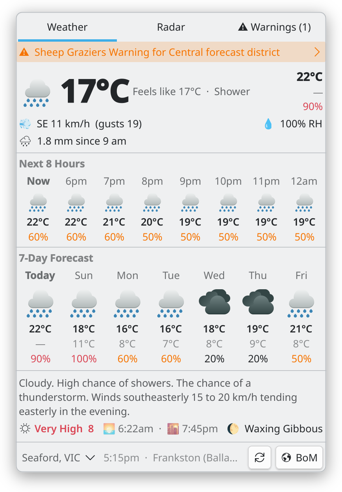
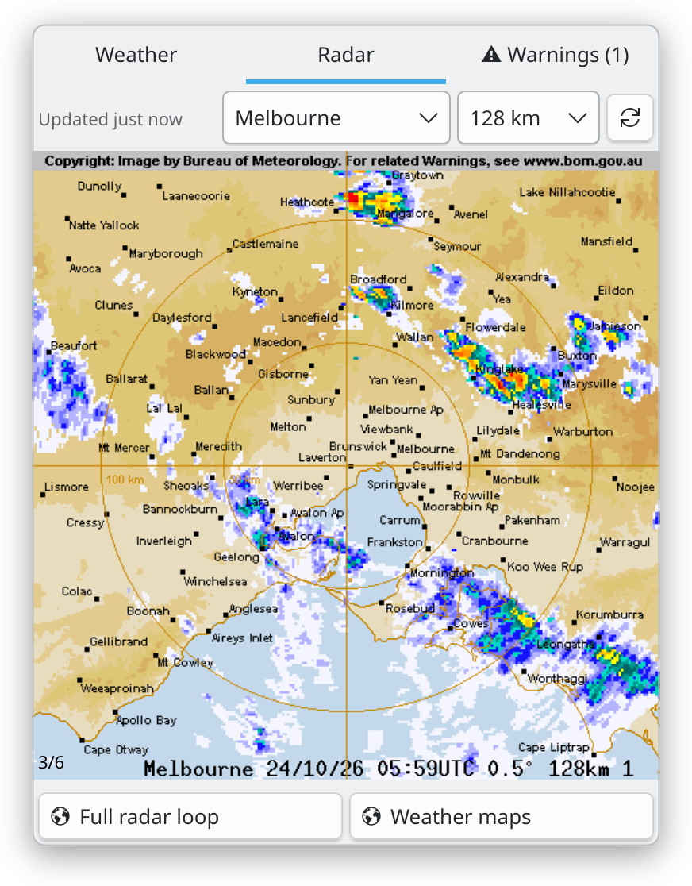
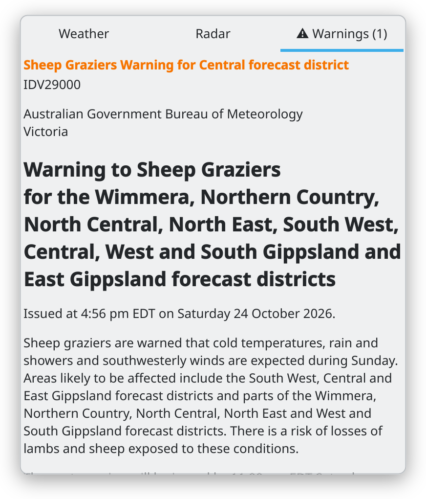
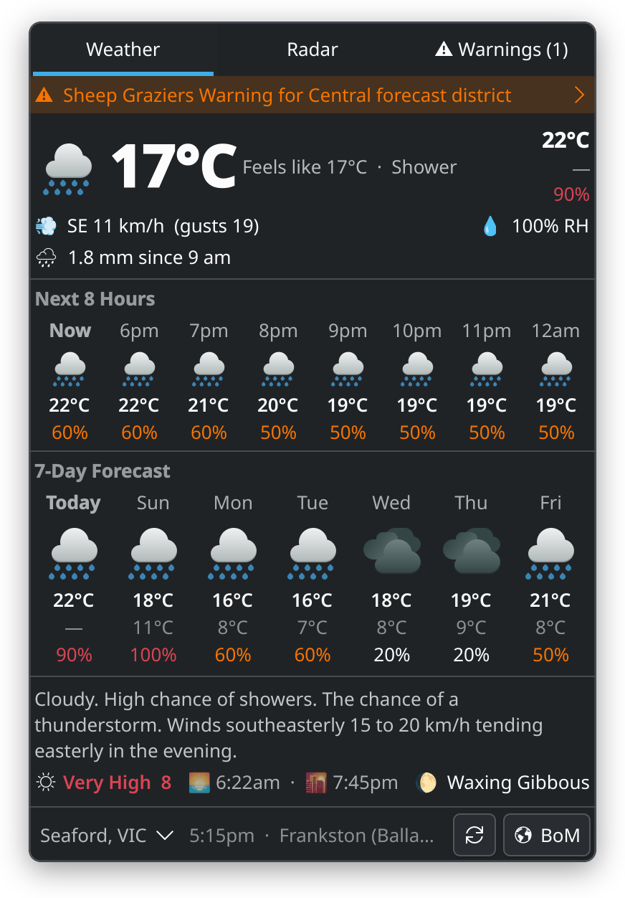
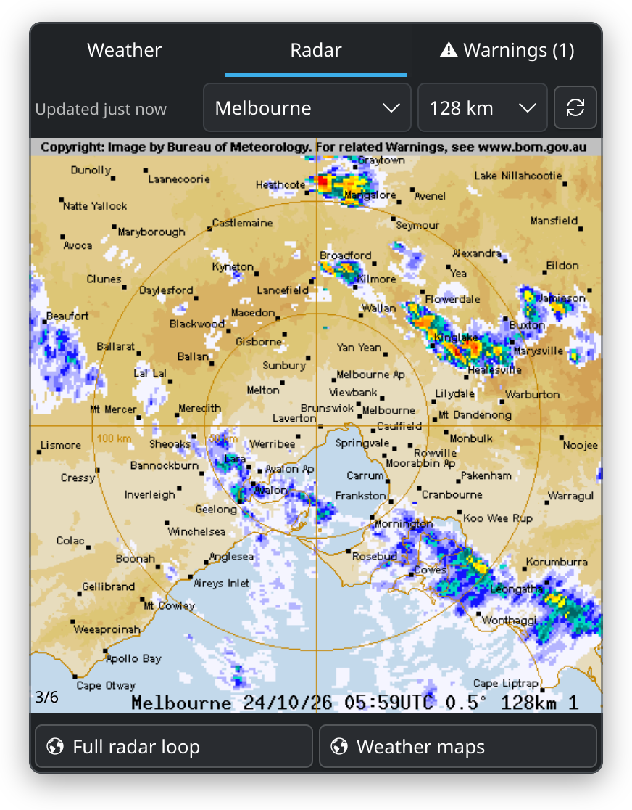
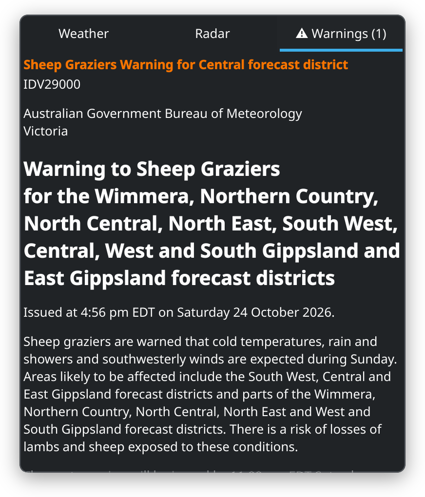

# Aussie Weather


A KDE Plasma 6 panel widget for Australian weather, sourced from the Bureau
of Meteorology's public API: current conditions, hourly and 7-day forecasts,
UV index, severe weather warnings, and an animated rain radar loop.

> **Unofficial client.** This widget is not affiliated with or endorsed by
> the Australian Bureau of Meteorology. Weather data © Australian Bureau of
> Meteorology. The widget identifies itself to BoM's API with a versioned
> User-Agent and polls every 10 minutes at most often; a failed poll is
> retried after 5 seconds, doubling, at most six times.

## Screenshots

| Weather | Radar | Warnings |
| --- | --- | --- |
|  |  |  |
|  |  |  |

## Features

- **Panel:** condition icon (day/night switches at actual sunset/sunrise,
  to the minute) + current temperature
- **Weather tab:** current conditions with feels-like, wind/gusts, humidity
  and rain since 9 am; next 8 hours
  (hover an hour for feels-like, wind, humidity, UV and rain detail); 7-day
  forecast (hover a day for the meteorologist's extended text); today's
  extended forecast; UV index with category colouring; sunrise/sunset times
  and moon phase (a moon replaces the UV reading at night)
- **Radar tab:** animated rain radar composited from BoM's transparency
  layers, with a frame counter and quick station/range switching — the
  station configured in settings stays the sticky default
- **Places:** save several places (home, school, work…) and switch between
  them by clicking the place's name at the bottom of the popup; each keeps
  its own radar station and range
- **Warnings tab:** appears only while warnings are current for your
  location; full warning text in a scrollable list, plus a banner on the
  Weather tab
- **Radar stations:** all 68 active BoM radar sites, enumerated with their
  available ranges (512/256/128/64 km), selectable by name — no product IDs
  to look up

## Install

**From the KDE Store:** right-click your panel → *Add Widgets* → *Get New
Widgets* → search "Aussie Weather".

**From a release package:**

```sh
kpackagetool6 --type Plasma/Applet --install net.tropism.plasma.aussieweather-<version>.plasmoid
# or, if already installed:
kpackagetool6 --type Plasma/Applet --upgrade net.tropism.plasma.aussieweather-<version>.plasmoid
```

**From source:**

```sh
git clone https://github.com/hamsolodev/plasma-aussieweather.git
cd plasma-aussieweather
kpackagetool6 --type Plasma/Applet --install "$(scripts/package.sh)"
```

`scripts/package.sh` needs `zip`, and `msgfmt` (gettext) once translations
exist; it prints the path of the `.plasmoid` it builds.

### Runtime requirement

`python3` must be on `PATH`. The widget fetches BoM API data and the radar
frame list with two small Python scripts in `contents/code/` (standard library
only; no third-party Python packages needed).

Warning maps are saved as PNG files under
`~/.cache/net.tropism.plasma.aussieweather/warnings/` (or under
`$XDG_CACHE_HOME`), one directory per location, while their warnings are
current. They are removed once no current warning uses them, and a
location no longer shown loses its maps after a day. The cache directory
must not be writable by other users (a group of your own is fine); the
widget keeps its own directories private (mode 0700). If they cannot be
made so, the maps are not shown and the widget says why.

## Configuration

- **Places** — one or more, each a location in `Suburb STATE` form
  (`Seaford VIC`, `Sydney NSW`) with its own radar station, picked by name,
  and range, which offers only what that station publishes. Pick the
  station nearest the place; smaller ranges show more detail. The marked
  place is shown; the popup switches between them too. The widget looks a
  place up once via the BoM location search, and again only when it
  changes.
- **Update interval** — 10–60 minutes (10-minute minimum is also enforced in
  code; BoM observations only update every ~10 minutes, so faster polling
  gains nothing).

## Troubleshooting

- **"Cannot reach BoM"** — api.weather.bom.gov.au is unreachable from this
  machine; the widget keeps showing the last data it had, dimmed in the
  panel once it is out of date, and retries.
- **"BoM returned an error"** — BoM answered but refused the request. BoM
  occasionally blocks unusual User-Agents; the widget sends
  `net.tropism.plasma.aussieweather/<version>`.
- **"The weather script failed"** — check that `python3` runs from a
  terminal; the message carries its error.
- **"No recent radar images"** — the station has published nothing in the
  last hour, usually because it is offline for maintenance. Switch to a
  neighbouring station from the Radar tab's quick picker.
- **Location resolves to the wrong place** — include the state suffix
  (`Springfield QLD` vs `Springfield SA`, in any case); only places in that
  state then match, and if none does the widget says the location was not
  found.

## Development

```sh
./scripts/test.sh            # Python tests of contents/code, QML tests of the helpers and model
./scripts/check-qml.py       # compile every QML file against the installed Plasma
./scripts/render.py OUTDIR   # screenshot each tab offscreen; fails on any QML warning
./scripts/package.sh         # build net.tropism.plasma.aussieweather-<version>.plasmoid
./scripts/make-icons.py      # remake the icon's copies after editing branding/
./translate/merge.sh         # regenerate translate/template.pot after string changes
```

The tests need `python3` and Qt 6's `qmltestrunner` (Fedora:
`qt6-qtdeclarative-devel`; Debian/Ubuntu: `qt6-declarative-dev-tools` and
`qml6-module-qttest`). `check-qml.py` and `render.py` also need KDE
Plasma 6's QML modules, and `render.py` PySide6 built against the same Qt
(Fedora: `python3-pyside6`); CI runs both in a Fedora container. CI fails
if `template.pot` is out of date, or if the icon's copies were not made
from today's `branding/` sources (`make-icons.py` needs ImageMagick with
librsvg, and Pillow; its `--check` only Python).

This repo is also consumed as a git submodule by a private multi-widget
repo; the widget package itself is `metadata.json` + `contents/` at the repo
root.

## License

GPL-2.0-or-later. This project is [REUSE](https://reuse.software/) compliant.
