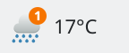
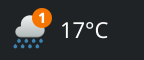

# Aussie Weather — Plasma 6 widget

Australian weather in your KDE panel: current conditions, hourly and 7-day
forecasts, UV, severe weather warnings with their maps, and an animated
rain radar, for as many places as you like to switch between — data from
the Bureau of Meteorology's public API.

**[Get it from the KDE Store](https://store.kde.org/p/2362509)**, or from
Plasma itself: right-click your panel → *Add Widgets* → *Get New Widgets* →
search "Aussie Weather". Release packages are on
[GitHub](https://github.com/hamsolodev/plasma-aussieweather/releases/latest).

*Unofficial client; not affiliated with or endorsed by the Bureau of
Meteorology. Weather data © Australian Bureau of Meteorology.*

| Weather | Radar | Warnings |
| --- | --- | --- |
|  |  |  |
|  |  |  |

In the panel:

See the [README](https://github.com/hamsolodev/plasma-aussieweather#readme)
for features, installation, and configuration, and the
[CHANGELOG](https://github.com/hamsolodev/plasma-aussieweather/blob/main/CHANGELOG.md)
for release history. Found a problem?
[Report it](https://github.com/hamsolodev/plasma-aussieweather/issues).
